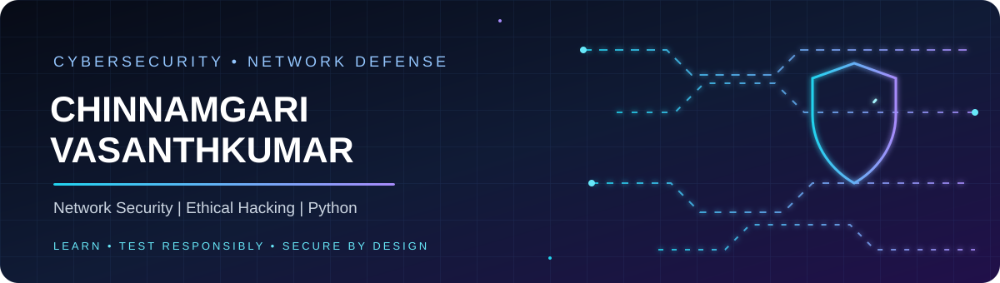

# Hi, I'm Chinnamgari Vasanthkumar 👋

### Cybersecurity | Network Security | Ethical Hacking | Python

  

  
  
  

📍 Prakasam, Andhra Pradesh, India  
🎓 B.Tech in Cyber Security — Bapatla Engineering College (2022–2026)  
🎯 Interested in Network Security, Security Operations, Vulnerability Assessment, and Cybersecurity Research

---

## 👨‍💻 About Me

I am a Cyber Security graduate with a strong interest in network defense, vulnerability assessment, digital forensics, OSINT, and secure application development. I enjoy exploring how systems and networks work, documenting security findings, and building practical projects that combine security with software development.

- 🔎 Practicing network reconnaissance and security assessment in controlled lab environments.
- 🛡️ Learning network security concepts, threat analysis, and security best practices.
- 🐍 Using Python for scripting, automation, and application development.
- 📚 Published research on a blockchain-enabled voting system with OTP-based authentication.
- 🤝 Open to entry-level opportunities and internships in **Network Security / Cybersecurity**.

> **Career goal:** Build practical experience in defensive security, security testing, incident analysis, and secure systems.

## 🧰 Technical Skills

| Area | Skills |
|---|---|
| Networking | TCP/IP, OSI Model, DNS, DHCP, VPN, Subnetting, Routing & Switching Fundamentals, VLANs, Network Segmentation |
| Security | Vulnerability Assessment, Penetration Testing Fundamentals, Threat Analysis, Firewalls, IDS/IPS Fundamentals, Incident Response Basics, Risk Assessment |
| Tools | Nmap, Wireshark, Kali Linux, OSINT frameworks |
| Digital Forensics | Cybercrime investigation fundamentals, evidence analysis, OSINT research |
| Programming | Python, C, Java, SQL, Bash scripting |
| Systems | Linux (Kali Linux/Ubuntu), Windows Server basics, SQL databases, Cloud fundamentals |
| Professional | Technical documentation, research and analysis, stakeholder communication, teamwork, project coordination |

## 🚀 Featured Projects

### 1. Network & Web Vulnerability Assessment Lab
- Practiced network reconnaissance and vulnerability scanning in a controlled lab environment.
- Used OSINT and scanning tools to identify common network and web-security weaknesses.
- Documented findings and remediation recommendations in structured reports.
- **Focus:** Nmap, OSINT, vulnerability assessment, technical reporting.

### 2. Secure OTP-Based Authentication for Blockchain-Enabled Voting System
- Designed a blockchain-enabled e-voting framework with OTP-based two-factor authentication.
- Developed the voter-verification workflow, data-integrity model, and audit-trail logic.
- Research work published in IJSREM in April 2026.
- **Publication DOI:** [10.55041/IJSREM60279](https://doi.org/10.55041/IJSREM60279)

### 3. AI-Powered Nearby Restaurant & Food Recommendation Platform
- Built a conversational AI concept using NLP intent parsing and WhatsApp API integration.
- Designed the workflow for location-aware recommendations without requiring a dedicated mobile app.
- **Focus:** NLP, Python/application logic, API integration.

### 4. Text-to-Speech Converter
- Developed a Python text-to-speech application using gTTS, NLTK, and Pygame.
- Added text preprocessing to improve pronunciation handling for technical terms.
- **Focus:** Python, NLP preprocessing, text-to-speech.

> **Portfolio note:** Add a link to each project's GitHub repository when you publish it. Do not link private, unfinished, or non-existent repositories.

## 📄 Research Publication

**“Secure OTP-Based Authentication Framework for Blockchain-Enabled Voting System”**  
International Journal of Scientific Research in Engineering and Management (IJSREM), Volume 10, Issue 04, April 2026.  
[Read publication / DOI](https://doi.org/10.55041/IJSREM60279)

## 🏅 Certifications & Training

- Cybersecurity Virtual Internship — Palo Alto Networks (EduSkills)
- Python Programming Intern — VaultofCodes
- Python Programming — Reliance Foundation Skilling Academy
- Security Expert Level-1 (Ethical Hacking)
- Digital Forensics Expert Level-1
- Cybersecurity in Network Security — Infosys SpringBoard
- Fundamentals of Computer Network Security Specialization — Coursera
- NLP Application — Project Expo Certificate

## 🎓 Education

**B.Tech — Cyber Security**  
Bapatla Engineering College, Bapatla | 2022–2026 | CGPA: 7.6/10

**Senior Secondary**  
APSWRS Junior College, Darsi | 2020–2022 | CGPA: 7.1/10

## 🌟 Leadership & Achievements

- NSS Commando — Social Awareness Campaigns (2023–2025)
- Student co-ordinator in BECTAGON (2024-2025)
- 🥇 First Prize — Promo design compitation (2025)

## 📊 GitHub Overview

<!-- Replace chinnamgari-vasanthkumar with your exact GitHub username in every URL below. -->

 

 

## 🤝 Connect With Me

- **Email:** [chinnamgarivasanthkumar@gmail.com](mailto:chinnamgarivasanthkumar@gmail.com)
- **LinkedIn:** www.linkedin.com/in/vasanthkumar-chinnamgari-783b88426
- **GitHub:** `https://github.com/chinnamgari-vasanthkumar`

---

*“Learn continuously. Test responsibly. Secure by design.”*

